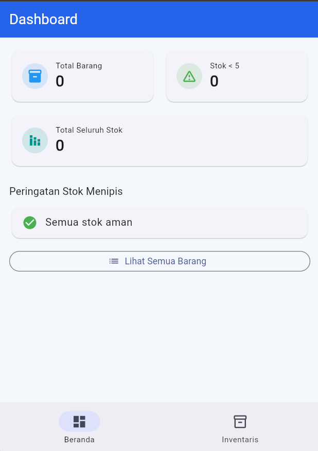
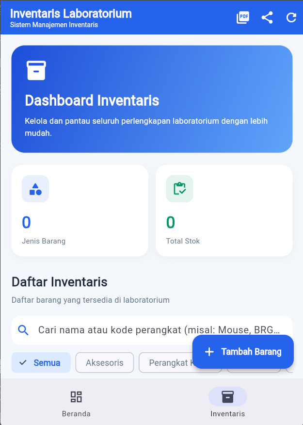
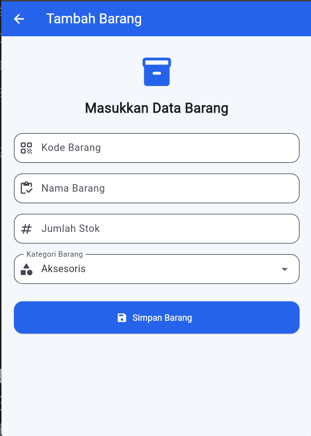
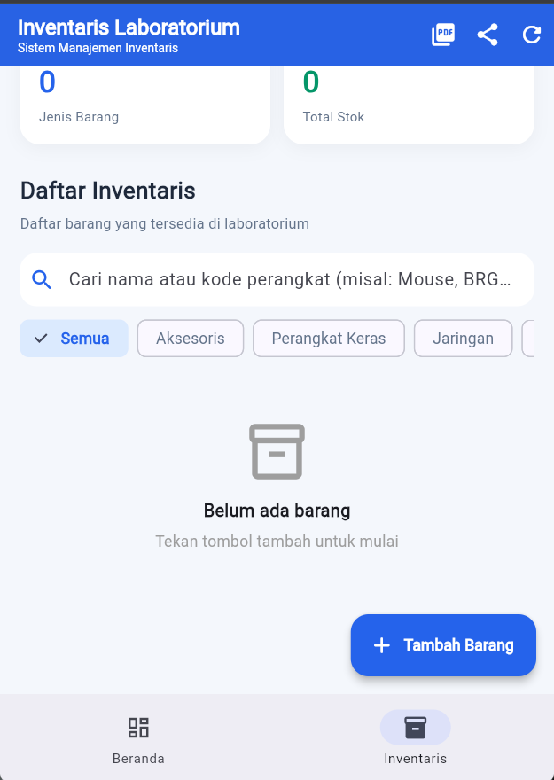
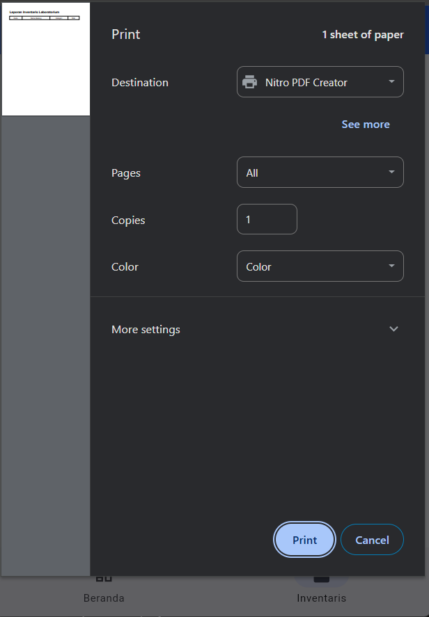

# Inventaris Laboratorium

Aplikasi pengelolaan inventaris laboratorium berbasis Flutter. Aplikasi mencatat kode, nama, jumlah stok, dan kategori barang, dengan penyimpanan lokal menggunakan SQLite.

Proyek ini dikembangkan secara berkelompok dalam repository **Wahyu_SistemInformasi24**.

## Daftar Isi

- [Tujuan dan Fungsi](#tujuan-dan-fungsi)
- [Anggota dan Peran](#anggota-dan-peran)
- [Fitur Aplikasi](#fitur-aplikasi)
- [Teknologi](#teknologi)
- [Persyaratan](#persyaratan)
- [Instalasi dan Menjalankan Aplikasi](#instalasi-dan-menjalankan-aplikasi)
- [Panduan Penggunaan](#panduan-penggunaan)
- [Screenshot Aplikasi](#screenshot-aplikasi)
- [Struktur Proyek](#struktur-proyek)
- [Laporan Pengujian](#laporan-pengujian)

## Tujuan dan Fungsi

Aplikasi membantu pengelola laboratorium mencatat perlengkapan, memantau persediaan, dan menemukan barang dengan lebih mudah. Ringkasan stok serta peringatan stok menipis membantu pemantauan, sedangkan ekspor PDF dan berbagi data mendukung penyusunan laporan inventaris.

## Anggota dan Peran

| No. Anggota | Nama | Peran dan Tanggung Jawab |
| --- | --- | --- |
| 1 | Wahyu | Code Reviewer; meninjau kode dan integrasi kontribusi tim. |
| 2 | Zidan | Integrasi database SQLite. |
| 3 | Oza | UI/UX halaman utama. |
| 4 | Defni | Form tambah dan ubah barang. |
| 5 | Reva | Fitur pencarian barang. |
| 6 | Dewo | Kategori barang dan filter kategori. |
| 7 | Rana | Dashboard dan ringkasan inventaris. |
| 8 | Rani | Ekspor PDF dan berbagi data. |
| 9 | Syahrul | QA, perbaikan bug, dan laporan pengujian. |
| 10 | FAOZI IMAM (Ozi) | Technical Writer; README dan dokumentasi screenshot aplikasi. |

## Fitur Aplikasi

| Fitur | Fungsi |
| --- | --- |
| Dashboard | Menampilkan total jenis barang, total seluruh stok, jumlah barang dengan stok di bawah 5, dan daftar peringatan stok menipis. |
| Inventaris lokal | Menyimpan data pada SQLite dan menampilkan daftar barang berdasarkan nama. |
| Tambah barang | Mencatat kode barang, nama barang, jumlah stok, dan kategori. |
| Ubah barang | Memperbarui nama, stok, dan kategori barang yang sudah tercatat. |
| Hapus barang | Menghapus barang setelah pengguna menyetujui dialog konfirmasi. |
| Validasi input | Memeriksa kolom wajib, kode berupa gabungan huruf dan angka, nama berupa huruf dan spasi, serta stok berupa bilangan bulat tidak negatif. Kode yang sudah digunakan ditolak saat penambahan. |
| Pencarian | Mencari barang berdasarkan nama atau kode tanpa membedakan huruf besar dan kecil. |
| Filter kategori | Menampilkan semua barang atau kategori Aksesoris, Perangkat Keras, Jaringan, dan Lainnya. Filter dapat digunakan bersama pencarian. |
| Reset dan muat ulang | Mengosongkan pencarian, mereset filter saat hasil kosong, serta memuat ulang data melalui tombol muat ulang. |
| Ekspor dan cetak PDF | Membuat laporan tabel berisi kode, nama barang, stok, dan kategori, lalu membuka dialog cetak. |
| Berbagi data | Membagikan daftar inventaris dalam bentuk teks melalui fitur berbagi perangkat. |

> Ekspor PDF dan berbagi teks menggunakan seluruh daftar inventaris yang dimuat, bukan hanya hasil pencarian atau filter yang sedang tampil.

## Teknologi

| Teknologi / Paket | Penggunaan |
| --- | --- |
| Flutter dan Dart | Pengembangan aplikasi dan antarmuka Material 3. |
| `sqflite` | Pengelolaan database SQLite lokal. |
| `path` | Penyusunan lokasi file database. |
| `pdf` | Pembuatan dokumen laporan PDF. |
| `printing` | Pembukaan dialog cetak untuk laporan PDF. |
| `share_plus` | Berbagi data inventaris sebagai teks. |
| Git dan GitHub | Pengelolaan versi dan kolaborasi tim. |

Nama paket proyek adalah `sistem_informasi24` dengan versi aplikasi `1.0.0+1`. Daftar dependensi lengkap tersedia di [pubspec.yaml](pubspec.yaml).

## Persyaratan

- Git untuk mengambil repository.
- Flutter SDK yang menyertakan Dart sesuai batas versi `^3.13.5` pada `pubspec.yaml` (minimal Dart 3.13.5 dan di bawah 4.0.0).
- Android Studio atau perangkat pengembangan Android dengan Android SDK yang dikonfigurasi untuk Flutter.
- JDK yang kompatibel dengan toolchain Android proyek; target Java/JVM pada konfigurasi aplikasi adalah 17.
- Android NDK `30.0.16248370`, sesuai konfigurasi di [android/app/build.gradle.kts](android/app/build.gradle.kts).
- HP Android dengan USB debugging aktif atau emulator Android yang sudah siap digunakan.
- Koneksi internet saat pertama kali mengambil dependensi Flutter dan komponen build Android.

### Dukungan Chrome

Folder web tersedia, tetapi implementasi database saat ini memakai `sqflite` tanpa backend database web. Karena itu, tampilan yang dapat dibuka di Chrome belum berarti fitur penyimpanan dan pengelolaan inventaris berfungsi penuh. Gunakan perangkat atau emulator Android untuk menjalankan seluruh alur aplikasi dengan database yang sesuai.

## Instalasi dan Menjalankan Aplikasi

### 1. Periksa lingkungan pengembangan

Jalankan perintah berikut melalui terminal dan lengkapi kebutuhan Android yang dilaporkan:

```bash
flutter doctor
```

### 2. Ambil proyek

```bash
git clone https://github.com/kaelvloper/Wahyu_SistemInformasi24.git
cd Wahyu_SistemInformasi24
```

Untuk membuka versi dokumentasi pada branch Ozi:

```bash
git checkout Ozi
git pull origin Ozi
```

Jika repository sudah tersedia secara lokal, buka folder proyek tersebut dan jalankan dua perintah branch di atas. Simpan perubahan lokal sebelum memperbarui branch.

### 3. Pasang dependensi

```bash
flutter pub get
```

### 4. Siapkan perangkat Android

Hubungkan HP dengan USB debugging aktif dan setujui permintaan izin debugging pada HP, atau jalankan emulator Android yang sudah dikonfigurasi. Periksa perangkat yang terdeteksi:

```bash
flutter devices
```

### 5. Jalankan aplikasi

Ganti `DEVICE_ID` dengan ID perangkat Android dari hasil perintah sebelumnya:

```bash
flutter run -d DEVICE_ID
```

Apabila hanya satu perangkat Android tersedia, aplikasi juga dapat dijalankan dengan `flutter run` dan memilih perangkat tersebut bila diminta.

## Panduan Penggunaan

1. Buka **Beranda** untuk melihat ringkasan inventaris dan peringatan stok menipis.
2. Pilih **Inventaris** atau **Lihat Semua Barang** untuk membuka daftar barang.
3. Tekan **Tambah Barang**, isi seluruh kolom, pilih kategori, lalu tekan **Simpan Barang**. Contoh kode valid: `BRG001`; contoh nama valid: `Mouse`; stok: `10`.
4. Gunakan kolom pencarian untuk nama atau kode barang, lalu pilih kategori bila diperlukan.
5. Gunakan tombol ubah atau hapus pada barang yang ingin dikelola. Penghapusan memerlukan konfirmasi.
6. Tekan ikon PDF untuk membuka laporan pada dialog cetak. Tujuan cetak atau penyimpanan PDF mengikuti pilihan yang tersedia pada perangkat.
7. Tekan ikon berbagi untuk membagikan data inventaris sebagai teks, atau ikon muat ulang untuk membaca kembali data lokal.

## Screenshot Aplikasi

Lima gambar berikut merupakan screenshot asli aplikasi. Ukuran tampil diperkecil secara proporsional; klik gambar untuk membuka ukuran aslinya. Pada screenshot ini, data inventaris masih kosong.

<table>
  <tr>
    <th width="50%">Dashboard</th>
    <th width="50%">Inventaris</th>
  </tr>
  <tr>
    <td align="center" valign="top">
      <a href="screenshots/dashboard.png"></a>
      <p>Ringkasan total barang, stok di bawah 5, total seluruh stok, dan bagian peringatan stok menipis.</p>
    </td>
    <td align="center" valign="top">
      <a href="screenshots/inventaris.png"></a>
      <p>Halaman inventaris dengan ringkasan persediaan, kolom pencarian, filter kategori, dan tombol Tambah Barang.</p>
    </td>
  </tr>
  <tr>
    <th>Form Barang</th>
    <th>Pencarian</th>
  </tr>
  <tr>
    <td align="center" valign="top">
      <a href="screenshots/form.png"></a>
      <p>Form penambahan barang yang memuat kode, nama, jumlah stok, kategori, dan tombol Simpan Barang.</p>
    </td>
    <td align="center" valign="top">
      <a href="screenshots/pencarian.png"></a>
      <p>Area pencarian nama atau kode dan pilihan kategori. Tampilan masih menunjukkan keadaan belum ada barang.</p>
    </td>
  </tr>
  <tr>
    <th colspan="2">Export PDF</th>
  </tr>
  <tr>
    <td colspan="2" align="center">
      <a href="screenshots/export_pdf.png"></a>
      <p>Dialog cetak menampilkan pratinjau laporan inventaris serta pilihan tujuan dan pengaturan cetak.</p>
    </td>
  </tr>
</table>

## Struktur Proyek

```text
Wahyu_SistemInformasi24/
├── lib/
│   ├── main.dart              # Navigasi, inventaris, pencarian, dan form
│   ├── dashboard_page.dart    # Ringkasan dan peringatan stok
│   ├── database_helper.dart   # Operasi SQLite
│   └── export_helper.dart     # Laporan PDF dan berbagi teks
├── screenshots/               # Lima screenshot asli untuk dokumentasi
├── android/                   # Konfigurasi aplikasi Android
├── test/                      # Pengujian Flutter
├── pubspec.yaml               # Metadata dan dependensi
├── README.md                  # Dokumentasi proyek
└── TESTING_REPORT.md          # Laporan QA dari Anggota 9
```

## Laporan Pengujian

Laporan pengujian yang disusun oleh Syahrul (Anggota 9) tersedia di [TESTING_REPORT.md](TESTING_REPORT.md).
